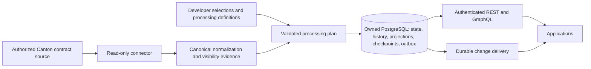

# Architecture

Status: Rust configuration, exact fixture values, scoped lifecycle state and local
CLI workflows are implemented. The [bounded reference store](storage.md) adds owned
PostgreSQL state, journal/checkpoint/outbox atomicity and recovery for synthetic
fixtures. PQS inspection is read-only; live ingestion, generated models/APIs and
durable stream delivery remain planned. Verified source authorization, archival
evidence, history coverage and handoff remain live-connector gates.

## System boundary

Source access is bounded by the operator's credentials and selection. API access
is independently bounded by each caller's grants. PostgreSQL is CantonGrid-owned;
any upstream PQS database is a read-only source, never a migration target.

## Module responsibilities

These are conceptual boundaries, not a committed crate layout.

| Module | Owns |
| --- | --- |
| CLI/configuration | Project scaffold, validation, command lifecycle and diagnostics. |
| Connectors | Verified source protocol, snapshots, update acquisition and capabilities. |
| Schema | Verified package metadata, Daml type mapping and schema versions. |
| Core | Canonical identities, lifecycle records, provenance and authorization context. |
| Processing | Declarative plan validation and deterministic projection execution. |
| Storage | Owned migrations, atomic writes, checkpoints, rebuilds and durable outbox. |
| API | Generated REST/GraphQL queries, authorization, pagination and stream delivery. |
| Examples | Outcomia and an unrelated Daml application using public configuration interfaces. |

Core modules must not depend on example packages. Connector-specific payloads
must not leak into the processing interface. Shared authorization rules belong in
the core policy boundary and must apply to every query and delivery path.

## Ingestion and recovery

1. Validate source identity, authorized scope, configuration and schema versions.
2. Acquire an active-contract snapshot and supported history through a verified
   snapshot/update handoff. The connector must document its actual guarantees.
3. Normalize records with source identity, stable contract/event identity,
   upstream position, observed time, ledger time when available, schema version,
   visibility evidence and ingestion provenance.
4. Apply lifecycle changes and configured processing. Commit canonical records,
   projections, checkpoint and outbox entries in one PostgreSQL transaction.
5. Resume from the committed position after interruption. Duplicate source
   deliveries must have no duplicate state effect.

Positions are opaque and scoped to a source, network and authorization epoch.
There is no universal block height or total ordering across independent sources.
A successful empty or truncated page does not prove archival. Failed parsing or
unsupported events must stop progress or enter an explicitly configured,
observable quarantine policy; they must never silently advance past lost data.
History coverage and pruning gaps are queryable metadata, not invented history.

## Generated storage and APIs

Canonical active contracts and supported lifecycle records provide a useful
baseline without a custom model. Verified Daml metadata enables typed fields;
otherwise expose validated generic payloads with explicit schema limitations.
Developer models declare typed outputs and processing rules. The planner derives
managed projection storage, indexes, query fields and change records.

Version migrations and processing definitions. Compatible additions may be
applied automatically under operator policy. Breaking changes need a versioned
rebuild and controlled promotion; never silently drop columns, reinterpret
historical values or run model changes against the upstream database. Rebuilds
must preserve privacy boundaries and expose their coverage/readiness.

Daml numeric and integer values require exact mappings. JSON, SQL and GraphQL
representations must preserve precision end to end, including aggregations.

## Queries and real-time changes

`serve` reads the indexed store. It must expose lag, coverage and readiness so
clients can distinguish empty results from incomplete ingestion. It does not
silently query a broader source when indexed data is unavailable.

Start durable delivery with authenticated SSE. Persist changes in the same
transaction as their state effects; notifications only wake consumers. Resume
using opaque scoped cursors, with at-least-once delivery and stable event IDs for
consumer deduplication. An expired retention window yields an explicit resync
response. PostgreSQL outbox order is delivery order, not a global Canton order.
GraphQL subscriptions can reuse this durable log in a later phase.

Policy changes, disconnections and replay are detailed in [security](security.md).
The developer interface is described in [processing model](processing-model.md).

## Current Rust module layout

| Crate | Implemented responsibility |
| --- | --- |
| `crates/core` | Configuration, exact values, source identity, envelopes, visibility/leases and reference lifecycle processing. |
| `crates/postgres` | Shared local connection validation and redacted database errors; no migrations. |
| `crates/storage` | Owned destination migration, journal recovery, atomic materialization/checkpoints/outbox and writer exclusion. |
| `crates/pqs` | Restricted read-only source metadata inspection; no destination migration or live copying. |
| `crates/ledger` | Bounded current-source grant checks and short-lived leases; separate from API caller authentication. |
| `crates/cli` | Command dispatch, separate source/storage operations and synthetic fixture workflows. |

GraphQL/API modules will be separate when their authenticated implementation
starts. Python `scripts/devtools` remains local provisioning/verification only.
