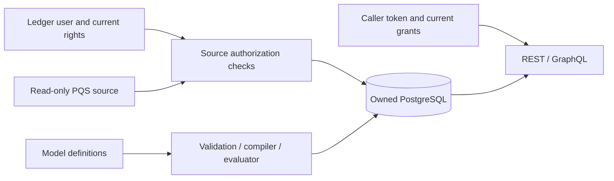

# Architecture

The indexer and APIs are Rust. Python under `scripts/devtools` manages local
infrastructure and verification. Applications supply selections and model
mappings; the engine has no Outcomia-specific branches.

## Modules

| Crate | Responsibility |
| --- | --- |
| `core` | Exact values, source identity, lifecycle, visibility and leases |
| `postgres` | Restricted connections and redacted database errors |
| `pqs` | Version-checked read-only snapshot/update paging |
| `ledger` | Current source-user and grant checks |
| `storage` | Owned migrations, state, history, checkpoints, outbox and projections |
| `runtime` | Worker, caller authentication and REST/GraphQL |
| `models` | Declarative definitions, exact evaluation and schema/client generation |
| `metadata` | Bounded offline DAR/LF 2.1 signature extraction |
| `cli` | Command dispatch |

## Source adapter

The [tested profile](verification.md#environment) uses a SELECT-only nonowner PQS
role and a separate Ledger credential with the exact configured CanReadAs set.
Source SQL is never a migration target.

| Schema041 interface | Use |
| --- | --- |
| `active(qname, offset)` | Active snapshot at a retained source-local boundary |
| `creates(qname, from, to)` / `archives(qname, from, to)` | Inclusive retained interval; resume after the acknowledged event key |
| `oldest_offset`, `latest_offset`, `pruned_offset` | Resolve explicit bounds inside the same read-only snapshot |

Pages use repeatable-read and order by offset plus source event primary key, so
events sharing an offset are not skipped. Archives require a previously observed
matching creation because schema041 omits archive witnesses. Missing rows are
not archives. History starts at the active snapshot and continues forward;
pruned/regressed bounds stop progress rather than inventing missing history.

The adapter uses the PostgreSQL driver for runtime template selection and checked
paged reads. SDK compatibility observations are in [verification](verification.md#source-observations).

## Destination and recovery

`storage init` explicitly applies checksummed migrations 001–006. Opening a store
only verifies it. Source-scoped advisory locks coordinate writers; expected
checkpoint comparisons reject stale workers. Canonical state, evidence/history,
model changes, checkpoint and outbox commit together. Exact duplicate deliveries
have no new effects. After an uncertain commit acknowledgement, reconnect and
inspect progress before retrying. Outbox sequence gaps are not ledger gaps.

The fixture reference path replays a bounded journal: 256 batches, 1,000 events
or 1 MiB per batch, 16 MiB journal text per generation. Live indexing updates SQL
rows directly and does not inherit the full-journal replay cap. Retained history
grows; automatic retention/erasure is not implemented.

Plans bind source/network/generation, templates, parties and physical endpoints/
database identity. Credential rotation preserves identity; changing a source
requires a reviewed generation. Source offsets are not global heights or counts.

## Models and queries

The registry stores immutable definitions by namespace/name/revision. Installation
compiles them into private tables and verifies real columns, keys, indexes,
ownership and grants against the plan. Identical definitions can share a physical
table; every row retains stream and contract identity. Registration and installation
do not activate processing or grant access.

Atomic `models bind` and staged rebuilds use the same source lock as ingestion.
Reads after acquiring it use READ COMMITTED to observe the preceding writer's
commit. Workers verify every bound alias and deduplicate shared physical models.
Create/archive projection updates join the canonical transaction.

For larger rebuilds, the inactive target is reserved and filled in bounded pages.
Ingestion transactionally queues changed contract IDs; catchup reconciles their
current state. Activation checks the expected old binding and empty queue before
switching metadata. Cleanup deletes unreferenced old rows in later bounded steps;
aliases retain their rows. Cancellation cleans only the inactive target.
See [models](guide/models.md) for commands, phases, limits and recovery.

Generic and model APIs use caller-scoped counts and keyset pagination in one
request snapshot. Canonical queries count/select authorized identities before
encoding page payloads. Generated model REST/GraphQL share validation and exact
native sorting. [API](guide/api.md) documents transport formats;
[security](security.md) defines authorization, final delivery checks and limits.

## Offline DAR metadata (#23)

`cantongrid metadata inspect <artifact.dar>` emits versioned JSON from a local
artifact. The isolated `cantongrid-metadata` crate reads ZIP entries without
extracting files and uses a metadata-only protobuf projection. It verifies each
original payload hash, resolves qualified signature references across packages
and preserves recursive types as references. Expressions and values are skipped;
this is not an executable LF validator or proof of deployment.

Only LF 2.1 is supported. Input, expansion, traversal and output bounds are in
[the metadata guide](guide/metadata.md). Unused interned type links are checked
once without expanding their trees; reachable signature types have separate
depth and work limits. No Ledger, database, SDK, JVM or protoc is required.
Schema synchronization (#24) and coordinated activation (#25) remain planned.

Dependency review and approval, 2026-11-21:

| Component | Decision |
| --- | --- |
| `canton-lf` 0.3.2 | Evaluated at SDK commit `5caaebc3eab380de827196663d4bb18b90ffd6f4`; ZIP 2.x fails current RustSec policy. Not added; no scanner exceptions. |
| Official LF archive schema | Metadata field projection from that pinned SDK's vendored Digital Asset Apache-2.0 schema. Source paths/checksums are in `crates/metadata/src/wire.rs`; attribution is retained in NOTICE. |
| `zip` 9.8.1 | Approved; default features disabled, DEFLATE only. Count checked before collecting entry metadata; no disk extraction. |
| `prost` 0.14.6 | Approved standard protobuf decoder. SHA-256 is checked against original payload bytes before interpretation. |
| `serde`, `serde_json`, `sha2` | Existing dependencies reused. |

Synthetic corruption/limit tests run in CI. Independent compiler inventory
comparisons for PoC, Visibility and Outcomia are dated in [verification](verification.md).
