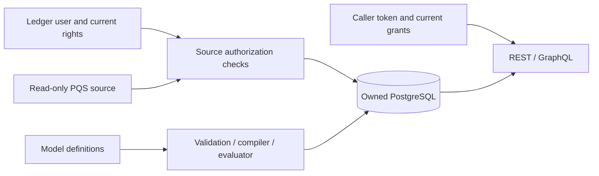

# Architecture

The indexer and APIs are Rust. Python under `scripts/devtools` manages local
infrastructure and verification. Applications supply selections and model
mappings; the engine has no Outcomia-specific branches.

## Modules

| Crate | Responsibility |
| --- | --- |
| `core` | Exact values, source identity, lifecycle, visibility and leases |
| `postgres` | Restricted connections and redacted database errors |
| `pqs` | Version-checked read-only snapshot/update paging |
| `ledger` | Current source-user and grant checks |
| `storage` | Owned migrations, state, history, checkpoints, outbox and projections |
| `runtime` | Worker, caller authentication and REST/GraphQL |
| `models` | Declarative definitions, exact evaluation and schema/client generation |
| `cli` | Command dispatch |

## Source adapter

The [tested profile](verification.md#environment) uses a SELECT-only nonowner PQS
role and a separate Ledger credential with the exact configured CanReadAs set.
Source SQL is never a migration target.

| Schema041 interface | Use |
| --- | --- |
| `active(qname, offset)` | Active snapshot at a retained source-local boundary |
| `creates(qname, from, to)` / `archives(qname, from, to)` | Inclusive retained interval; resume after the acknowledged event key |
| `oldest_offset`, `latest_offset`, `pruned_offset` | Resolve explicit bounds inside the same read-only snapshot |

Pages use repeatable-read and order by offset plus source event primary key, so
events sharing an offset are not skipped. Archives require a previously observed
matching creation because schema041 omits archive witnesses. Missing rows are
not archives. History starts at the active snapshot and continues forward;
pruned/regressed bounds stop progress rather than inventing missing history.

The adapter uses the PostgreSQL driver for runtime template selection and checked
paged reads. SDK compatibility observations are in [verification](verification.md#source-observations).

## Destination and recovery

`storage init` explicitly applies checksummed migrations 001–006. Opening a store
only verifies it. Source-scoped advisory locks coordinate writers; expected
checkpoint comparisons reject stale workers. Canonical state, evidence/history,
model changes, checkpoint and outbox commit together. Exact duplicate deliveries
have no new effects. After an uncertain commit acknowledgement, reconnect and
inspect progress before retrying. Outbox sequence gaps are not ledger gaps.

The fixture reference path replays a bounded journal: 256 batches, 1,000 events
or 1 MiB per batch, 16 MiB journal text per generation. Live indexing updates SQL
rows directly and does not inherit the full-journal replay cap. Retained history
grows; automatic retention/erasure is not implemented.

Plans bind source/network/generation, templates, parties and physical endpoints/
database identity. Credential rotation preserves identity; changing a source
requires a reviewed generation. Source offsets are not global heights or counts.

## Models and queries

The registry stores immutable definitions by namespace/name/revision. Installation
compiles them into private tables and verifies real columns, keys, indexes,
ownership and grants against the plan. Identical definitions can share a physical
table; every row retains stream and contract identity. Registration and installation
do not activate processing or grant access.

Atomic `models bind` and staged rebuilds use the same source lock as ingestion.
Reads after acquiring it use READ COMMITTED to observe the preceding writer's
commit. Workers verify every bound alias and deduplicate shared physical models.
Create/archive projection updates join the canonical transaction.

For larger rebuilds, the inactive target is reserved and filled in bounded pages.
Ingestion transactionally queues changed contract IDs; catchup reconciles their
current state. Activation checks the expected old binding and empty queue before
switching metadata. Cleanup deletes unreferenced old rows in later bounded steps;
aliases retain their rows. Cancellation cleans only the inactive target.
See [models](guide/models.md) for commands, phases, limits and recovery.

Generic and model APIs use caller-scoped counts and keyset pagination in one
request snapshot. Canonical queries count/select authorized identities before
encoding page payloads. Generated model REST/GraphQL share validation and exact
native sorting. [API](guide/api.md) documents transport formats;
[security](security.md) defines authorization, final delivery checks and limits.

## Planned DAR metadata extraction (#23)

The first command will be `cantongrid metadata inspect <dar>`. It reads a local
artifact offline and emits versioned JSON; it does not upload, activate models,
change source grants or claim that the package is deployed. Synchronization (#24)
and coordinated activation (#25) remain separate work.

Proposed implementation: an isolated `cantongrid-metadata` library with a bounded
ZIP reader and a metadata-only protobuf schema projection. Start with explicitly
supported LF 2.1; reject unknown/dev versions. Preserve exact package hashes,
package names/versions, dependency references, templates/choices, records,
variants/enums, type parameters, optionals/lists, Numeric scales and opaque
ContractId targets. Keep type references qualified rather than expanding recursive
types indefinitely. Unsupported constructs must be reported, never guessed.

Dependency review (2026-11-21):

| Component | Decision |
| --- | --- |
| `canton-lf` 0.3.2 / Nodejumper SDK | Evaluated at `5caaebc3eab380de827196663d4bb18b90ffd6f4`; it depends on ZIP 2.x, flagged by the current RustSec policy. Do not add it or scanner exceptions. |
| Official LF archive schema | Use the metadata field tags from the SDK's vendored Digital Asset Apache-2.0 schema; record upstream pin/checksums and retain attribution. Expressions/bytecode are outside metadata output. |
| `zip` 9.8.1 | Proposed new runtime dependency, no default features, DEFLATE only. Central-directory reads into bounded memory; never extract to disk. MSRV 1.89 is within this project's 1.100 toolchain. |
| `prost` 0.14.6 | Proposed new runtime dependency for standard protobuf decoding. Verify the declared SHA-256 against original payload bytes before interpreting metadata. |
| `serde`, `serde_json`, `sha2` | Reuse existing workspace versions. No SDK/JVM/protoc executable required at runtime. |

The user approved both new runtime dependencies on 2026-11-21 under the supplied
build spec’s interoperable-components rule. No SDK/JVM/protoc runtime dependency
or scanner exception is introduced.

Limits must cover input bytes, entry count, individual/total expanded bytes,
manifest length, protobuf/type depth and emitted metadata. Reject encrypted entries,
unsafe/duplicate paths, duplicate manifest keys, missing main packages, bad hashes,
invalid interning/references and missing dependencies. Sort unordered collections
for deterministic JSON/fingerprints while retaining declaration/parameter order.
Test corruption/version/resource limits with synthetic archives and compare pinned
real PoC/Visibility/Outcomia artifacts with independent compiler metadata. Real
artifact checks are local evidence, not ledger or runtime compatibility claims.
