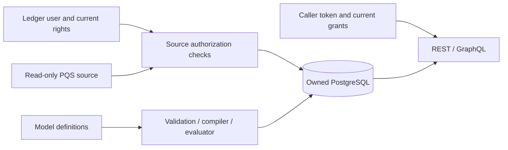

# Architecture

- **Languages:** the indexer and APIs are written in Rust. Python under
  `scripts/devtools` only manages local infrastructure and checks.
- **Applications:** they supply template selections and model mappings. The
  engine has no application-specific branches.

| Crate | Responsibility |
| --- | --- |
| `core` | Exact values, source identity, lifecycle, visibility, leases, lineage proofs |
| `postgres` | Restricted connections, redacted errors |
| `pqs` | Version-checked read-only snapshot and update paging |
| `ledger` | Current source-user and grant checks, HTTPS |
| `storage` | Migrations, state, history, checkpoints, outbox, projections, relationships, joins, inspector, reconciliation |
| `runtime` | Worker, caller authentication, REST/GraphQL |
| `models` | Definitions, exact evaluation, schema and client generation |
| `metadata` | Offline DAR / LF 2.1 signature extraction |
| `sync` | DAR-driven schema sync and impact reports |
| `cli` | Commands |

## Source

**Access.**
- **PQS:** a SELECT-only PQS role that isn't the owner.
- **Ledger:** a separate Ledger credential with exactly the configured CanReadAs
  set.
- **No migrations:** the source is never migrated.

| Schema041 interface | Use |
| --- | --- |
| `active(qname, offset)` | Active snapshot at a retained boundary |
| `creates` / `archives(qname, from, to)` | Inclusive interval, resuming after the acknowledged event key |
| `oldest_offset`, `latest_offset`, `pruned_offset` | Bounds inside the same snapshot |

**Paging.**
- **Ordering:** repeatable-read pages ordered by offset and then the event key,
  so events at the same offset aren't skipped.
- **Archives:** schema041 omits archive witnesses, so an archive needs a create
  that was already observed. A missing row isn't an archive.
- **Bounds:** history starts at the snapshot and moves forward. Pruned or
  regressed bounds stop progress.

**Exercises (opt-in tree mode, migration 009).**
- **Receipts:** atomic forward transactions record exercise receipts.
- **Lineage:** typed creation metadata feeds direct lineage (migration 010).
  - **Proof:** an edge is proven only from a complete recorded subtree.
  - **Partial views:** they can show children without the factory, so a general
    immediate-parent proof isn't claimed.

**HTTPS.**
- **Endpoints:** Ledger and health endpoints may use certificate-verified HTTPS
  (`reqwest` with Rustls).
  - **Not allowed:** redirects, proxies and plaintext fallback.
  - **Identity:** the transport and identity provider are part of the source
    identity.
- **PostgreSQL:** stays numeric-loopback, so a tunnel is needed for remote PQS.
- **Identity provider:** the issuer and the returned identity provider must both
  match explicit settings.

## Destination

**Migrations.**
- **Applying:** `storage init` applies checksummed migrations 001–012.
- **Opening:** opening a store only verifies them.

**One transaction per page.**
- **What it contains:** canonical state, evidence, history, model changes, the
  checkpoint and the outbox.
- **Locking:** source-scoped advisory locks coordinate writers.
- **Stale workers:** expected-checkpoint checks reject them.
- **Duplicates:** an exact duplicate delivery has no effect.
- **Uncertain commits:** reconnect and inspect before retrying.

**Plans.**
- **Identity:** a plan binds the source, network, generation, templates, parties
  and endpoints.
- **Credential rotation:** it keeps the identity.
- **Changing source:** needs a reviewed generation.
- **Offsets:** they're source-local, not global heights.

**Fixture path.**
- **Journal limits:** 256 batches, with up to 1,000 events or 1 MiB per batch, and
  16 MiB per generation.
- **Live indexing:** writes rows directly.
- **Retention:** history grows, and there's no automatic retention.

## Models and queries

**Registry and install.**
- **Registry:** immutable definitions by namespace, name and revision.
- **Install:** compiles a private table and verifies columns, keys, indexes,
  ownership and grants.
- **Shared tables:** identical definitions share a table, and every row keeps its
  stream and contract.

**Binding.**
- **Locking:** binding and staged rebuilds take the ingestion lock.
- **Atomic updates:** create and archive updates join the canonical transaction.
- **Staged targets:** a staged target is filled in pages while ingestion queues
  changed IDs for catchup.
- **Activation:** checks the old binding and an empty queue, then switches.

**Reads.**
- **Paging:** caller-scoped counts and keyset pagination in one snapshot.
- **Payloads:** payloads are encoded only for the page.

**Composition**, all in `storage::model_projection` and `storage::lineage`:
- **Relationships:** pin target revisions and resolve only visible endpoints.
- **Joins:** intersect visibility before fanout, and hash visible results for
  cursor invalidation.
- **Inspector:** reads committed provenance and compares SQL records natively.

**Upgrades.**
- **Manifest:** binds the old and new additive selection, the checkpoint, the DAR
  hash and the targets.
- **Migrations:** 007 keeps handoff evidence and 008 holds paged jobs.
- **Publication:** reads and ingestion are blocked until a complete prefix is
  ready. The final page switches the selection and the aliases.

**Metadata and sync.**
- **Metadata:** `cantongrid-metadata` reads DAR ZIP entries in memory, checks
  payload hashes and decodes a metadata-only protobuf projection of the official
  LF schema (vendored, Apache-2.0, see NOTICE).
- **Sync:** reuses it, together with the model compiler. Removals and type changes
  stop generation, and renames are never guessed.

## Delivery and history

- **Temporal reads:** rebuild membership at an acknowledged offset from immutable
  create and archive evidence. Incomplete or over-budget history is unavailable.
- **Delivery:** reuses the transactional outbox.
  - **Subscriptions (migration 011):** caller-bound, with random receipt cursors.
  - **Locking:** reads, ACKs and pruning serialize on the writer lock.
  - **Gaps:** pruning marks a gap only for unacknowledged visible events.
- **Bootstrap (migration 012):** captures the baseline and the feed anchor under
  the writer lock.
- **Health:** source health, worker freshness, public readiness and operator
  counters are kept separate.

## Dependencies

New third-party dependencies need review and approval. Recorded decisions:

| Component | Decision |
| --- | --- |
| `canton-lf` 0.3.2 | Not added: its ZIP 2.x fails RustSec policy |
| Official LF archive schema | Vendored metadata projection; paths and checksums in `crates/metadata/src/wire.rs` |
| `zip` 9.8.1 | Default features off, DEFLATE only, no disk extraction |
| `prost` 0.14.6 | Decodes only after SHA-256 matches |
| `reqwest` `rustls` feature | Approved 2026-11-21; adds ISC and CDLA-Permissive-2.0 to the license allowlist |
