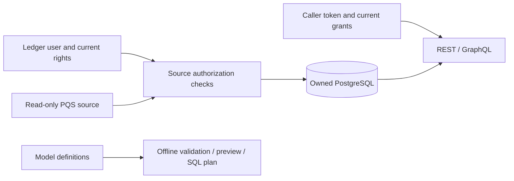

# Architecture

The runtime and APIs are Rust. Python under `scripts/devtools` manages local
infrastructure and checks. Application selections and model definitions live in
configuration; core code has no Outcomia-specific behavior.

## Modules

| Crate | Responsibility |
| --- | --- |
| `core` | Exact values, source identity, lifecycle and visibility/lease rules |
| `postgres` | Connection restrictions and redacted database errors |
| `pqs` | Version-checked read-only snapshot/update paging |
| `ledger` | Current source-user and grant checks |
| `storage` | Owned migrations, state, history, checkpoints and outbox |
| `runtime` | Worker, caller authentication and REST/GraphQL |
| `models` | Declarative definitions, exact evaluation and SQL plans |
| `cli` | Command dispatch |

## Source adapter

The tested source is Canton 3.5.7 with Scribe 3.5.4/schema041 and PostgreSQL 14.25.
It uses a SELECT-only nonowner SQL role and a separate Ledger credential whose
CanReadAs set matches the configured scope. Source SQL is never a migration target.

| Interface | Use |
| --- | --- |
| `active(qname, offset)` | Active snapshot at a retained source-local boundary |
| `creates(qname, from, to)` / `archives(qname, from, to)` | Inclusive retained interval; resume strictly after the acknowledged event key |
| `oldest_offset`, `latest_offset`, `pruned_offset` | Resolve explicit bounds inside the same read-only snapshot |

Each page uses repeatable-read and orders by offset plus source event primary key.
The tie breaker prevents skipping events at the same offset. Schema041 archives
have empty witnesses: the explicit prior-create policy requires a matching
observed creation and current rights. Orphan archives fail. A missing snapshot
row is never treated as an archive.

History starts with the captured active snapshot and continues forward. It does
not reconstruct contracts created and archived before that boundary. Pruning,
regressed bounds and incompatible source bindings stop progress.

Nodejumper's Rust SDK v0.3.2 decoded the installed rows correctly. The initial
adapter uses the existing PostgreSQL driver because it needs event/projection
identity, runtime template selections and a single checked paged transaction that
the evaluated typed client did not expose. See [evidence](verification.md).

## Destination and recovery

`storage init` explicitly applies immutable checksummed migrations 001–005 to the
owned destination. Opening a store does not migrate it. Initialization checks
ownership, schema identity and role restrictions; checksum drift fails.

A delivery commits canonical state, history/evidence, checkpoint and outbox in
one transaction. Source-scoped advisory locks coordinate writers; an expected
checkpoint comparison rejects stale live writers. Duplicate exact deliveries
have no new effects. After an uncertain commit acknowledgement, reopen and check
committed progress before retrying. Outbox sequence gaps are not ledger gaps.

The fixture reference path replays a bounded journal: 256 batches, 1000 events or
1 MiB per batch, 16 MiB journal text per source generation. Live indexing updates
SQL state directly and does not inherit the full-journal replay cap. Retained
history still grows; automatic retention/erasure is not implemented.

Plans bind source/network/generation, templates, parties and physical source
endpoints/database identity. Credential rotation preserves identity; changing a
source under an existing generation cannot reuse its offsets. Source positions
are not global heights or event counts.

## Queries and models

REST and GraphQL share authorized SQL counts/keyset pages. Current source and
caller rights are checked before reading and before delivery. Public events omit
raw witness sets, persistence envelopes and source primary keys. See
[security](security.md) and [API usage](guide/api.md).

Model definitions can now be registered under an operator project namespace,
independent from source checkpoints. Registration is atomic and immutable per
namespace/name/revision; reads validate the stored fingerprint. The registry has
no update/delete API, but its database owner remains trusted and can alter SQL.
It does not activate models or grant access to inputs.

The operator installer compiles the registered model, creates a private table and
links the revision in one transaction. Stored definition/DDL hashes are checked
against PostgreSQL's actual columns, keys, indexes, ownership and grants. Existing
unmanaged tables and drift are rejected, not adopted or repaired. Identical
definitions can share a physical table; source identity remains part of every row key.
Installation does not activate processing or copy contracts.

Source bindings select installed revisions for an already indexed physical plan.
Binding, backfill, promotion, ingestion and idle observation use the same source
writer lock. Backfill reads after lock acquisition under READ COMMITTED, ensuring
it sees a preceding worker's commit. It is bounded and promotes atomically;
failure preserves the old binding. Model changes leave the source plan untouched.

Workers verify every bound alias/physical schema each page and deduplicate
identical physical revisions. Current-state model inserts/deletes join the
canonical lifecycle/history/outbox/checkpoint transaction. Rows retain source and
contract identity; models never grant visibility. See [limits](guide/models.md#bind-and-backfill-a-source).

Caller-scoped model pages/counts and typed GraphQL are still pending. Future
cursors must bind model revisions as well as source and grants. Joins require
access to every input; aggregates need an explicit scope. No public durable
stream is served yet.
